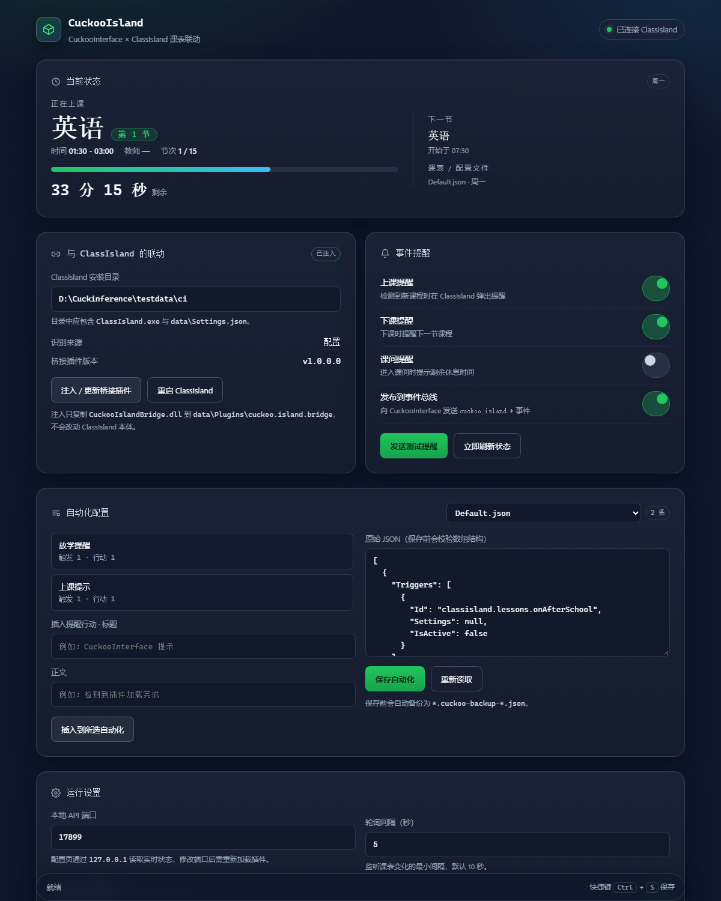

# CuckooIslandBase

把 **CuckooInterface** 和 [ClassIsland](https://github.com/ClassIsland/ClassIsland) 接起来的 Base 插件。

它读取 ClassIsland 的课表，把「当前在上什么课」变成 CuckooInterface 的事件；
同时可以反向把 CuckooInterface 的事件变成 ClassIsland 的提醒。



| 项目 | 值 |
| --- | --- |
| 插件 ID | `com.cuckoo.plugin.cuckoo_island` |
| 类型 | Base（`type: 42`） |
| 运行时 | Python（需在「运行时」页面选择 64 位 CPython 3.8+） |
| 验证环境 | ClassIsland 2.1.0.x、CuckooInterface `master`（2026-11） |
| 平台 | Windows |

## 功能

1. **读课表**：从 `data\Settings.json` 取 `SelectedProfile`，解析 `data\Profiles\<profile>.json` 的 `TimeLayouts / ClassPlans / Subjects`，算出当前科目、教师、节次、起止时间、剩余时长、下一节。
2. **发事件**：状态变化时向 EventBus 发布 `cuckoo.island.*` 事件（见下表），供 Active 插件订阅。
3. **改自动化**：读取 `data\Config\Automations\*.json`，可整体编辑并保存（自动备份），也可一键插入 `classisland.showNotification` 行动。
4. **事件提示**：自动把 `island-bridge\CuckooIslandBridge.dll` 注入 ClassIsland 的 `data\Plugins\cuckoo.island.bridge`，由它把事件队列转成 ClassIsland 提醒。
5. **配置页**：当前课程卡片、联动状态、提醒开关、自动化编辑、运行设置。

## 目录结构

```text
Base/CuckooIslandBase/
├── META-INF.json              # 插件元数据（打包后必须位于压缩包根目录）
├── main.py                    # 插件入口：课表解析 / 事件 / HTTP API
├── config.html                # 配置页（WebView2，深色主题）
├── island-bridge/             # 预编译的 ClassIsland 插件，注入时原样复制
│   ├── CuckooIslandBridge.dll
│   └── manifest.yml
├── src/                       # ClassIsland 桥接插件的 C# 源码（二次开发用）
│   ├── CuckooIslandBridge.csproj
│   ├── Plugin.cs
│   ├── CuckooNotificationProvider.cs
│   ├── manifest.yml
│   └── README.md
├── docs/preview.png
├── build.ps1                  # 编译桥接插件 + 打包
└── README.md
```

> `island-bridge/CuckooIslandBridge.dll` 是**运行时资源**，不是无关构建产物：插件需要它完成自动注入。源码在 `src/`，可自行编译替换。

## 依赖

- CuckooInterface（Python Kernel 已选中 64 位 CPython 3.8+）；
- ClassIsland 2.x（桥接插件声明 `apiVersion: 2.0.0.0`）；
- 仅二次开发桥接插件时需要 .NET 8 SDK。

## 安装

1. 构建或打包：

   ```powershell
   # 在 Base/CuckooIslandBase 目录下
   ./build.ps1 -ClassIslandDir "D:\Apps\ClassIsland"   # 编译桥接插件并打包 zip
   # 或直接打包现有文件（确保 META-INF.json 在压缩包根目录）
   Compress-Archive -Path * -DestinationPath CuckooIslandBase.zip
   ```

2. 把 zip 放进 CuckooInterface 的 `user/Base/`；
3. 重启 CuckooInterface →「插件」页面启用 **CuckooIslandBase**；
4. 打开「配置」页面：
   - 填写 **ClassIsland 安装目录**（包含 `ClassIsland.exe` 与 `data\Settings.json`），保存；
   - 点「注入 / 更新桥接插件」；
5. 重启 ClassIsland（配置页有按钮），让桥接插件加载；
6. 点「发送测试提醒」验证链路。

ClassIsland 目录留空时会依次尝试：`classisland://` 注册表协议 → 卸载表 → 运行中的进程 → 常见安装路径。绿色版或迁移过目录时请手动填写。

## 配置项

| 键 | 默认值 | 说明 |
| --- | --- | --- |
| `classisland_dir` | `""` | ClassIsland 安装目录；留空自动探测 |
| `http_port` | `17893` | 配置页使用的本地 API 端口（仅监听 `127.0.0.1`） |
| `poll_seconds` | `10` | 轮询间隔（最小 3 秒） |
| `emit_events` | `true` | 是否向事件总线发布事件 |
| `notify_lesson_start` | `true` | 上课提醒 |
| `notify_lesson_end` | `true` | 下课提醒（含下一节） |
| `notify_break` | `false` | 课间提醒 |
| `auto_inject_bridge` | `true` | 桥接插件版本不一致时自动同步 |
| `automation_file` | `Default.json` | 当前编辑的自动化文件 |

## 发布的事件

| 事件 | 触发时机 | 载荷 |
| --- | --- | --- |
| `cuckoo.island.state` | 任意状态变化 | 完整状态对象（科目、节次、剩余秒数、下一节等） |
| `cuckoo.island.lesson.started` | 进入新的一节课 | `subject / teacher / index / count / startAt / endAt` |
| `cuckoo.island.lesson.ended` | 下课 | `subject / next / nextStartAt` |
| `cuckoo.island.break.started` | 进入课间 | `name` |
| `cuckoo.island.bridge.installed` | 注入或更新桥接插件 | `version / target` |

## 本地 API

配置页通过 `http://127.0.0.1:<http_port>/api` 访问；也可被其它本地工具复用。

| 方法 | 路径 | 说明 |
| --- | --- | --- |
| GET | `/api/state` | 课程状态 + 配置 + 桥接状态 + 自动化摘要 |
| GET | `/api/config` | 当前配置 |
| POST | `/api/config` | 合并保存配置 |
| GET | `/api/automations?file=` | 读取自动化文件 |
| POST | `/api/automations` | `{ "items": [...] }` 覆盖保存（自动备份） |
| POST | `/api/automations/insert` | `{ "index": 0, "title": "", "message": "" }` 插入提醒行动 |
| POST | `/api/notify` | `{ "title": "", "message": "", "duration": 6 }` 推送提醒 |
| POST | `/api/inject` | 注入 / 更新桥接插件 |
| POST | `/api/restart-classisland` | 结束并重启 ClassIsland |
| GET | `/api/health` | 存活检查 |

## 工作原理

```text
ClassIsland data/
├── Settings.json                  ← 当前档案、单周起始时间
├── Profiles/Default.json          ← 时间表 / 课表 / 科目
├── Config/Automations/*.json      ← 可读可写
└── Plugins/cuckoo.island.bridge/
    ├── CuckooIslandBridge.dll     ← 由本插件注入
    └── bridge/notifications.jsonl ← 提醒队列（本插件追加，桥接插件消费）
```

CuckooInterface 的 Core IPC 是自定义二进制帧，ClassIsland 的 IPC 基于 `dotnetCampus.Ipc`，
两边要互通都得重新实现对方协议。因此这里用**文件队列**：Python 侧追加 JSONL，C# 侧按偏移量读取，
零额外依赖、可直接用文本工具排查，对两个宿主都没有侵入。

## 构建桥接插件

```powershell
dotnet build src/CuckooIslandBridge.csproj -c Release -p:ClassIslandDir="D:\Apps\ClassIsland\app-2.1.0.1-0"
```

`ClassIslandDir` 需指向包含 `ClassIsland.Core.dll` 的目录（安装根目录下的 `app-x.y.z`）。
构建后把 `CuckooIslandBridge.dll` 与 `manifest.yml` 复制到 `island-bridge/`。

## 测试情况

- **课表解析**：用真实 ClassIsland 2.1.0.1 课表验证 5 个时间点——06:30 空闲、07:10 第 1 节英语（剩 15 分）、08:20 第 3 节语文、12:00 下一节自习、23:30 无后续课，结果与 ClassIsland 显示一致。
- **接口**：`/api/state`、`/api/config`、`/api/notify`、`/api/inject`、`/api/automations`、`/api/automations/insert` 均通过样例数据联调（注入返回 v1.0.0.0，插入行动后文件结构正确且生成备份）。
- **桥接插件**：以 ClassIsland 2.1.0.1 的 `ClassIsland.Core.dll` 编译通过，并用反射校验入口类型 `[PluginEntrance] + PluginBase`、提醒提供方 `NotificationProviderBase + [NotificationProviderInfo]` 与 `IHostedService` 实现。
- **未覆盖**：启动真实 ClassIsland 的端到端弹窗验证（避免在测试机上弹窗），以及低版本 ClassIsland 的兼容性。

## 已知限制

- 只处理当天的标准课表，不处理临时课表（`TempClassPlan`）、叠加课表（`Overlay`）、调课与手动切换；
- 单双周依据 `SingleWeekStartTime` 推导，`MultiWeekRotationOffset` 的多周轮换未纳入；
- ClassIsland 写课表时可能读到半截 JSON，此时状态回退到上一次成功值并记录错误；
- 桥接插件注入后必须重启 ClassIsland 才会加载；
- ClassIsland 未运行时产生的提醒不会补发（桥接插件启动时定位到队尾，避免刷屏）；
- 目录探测、进程快照等实现依赖 Windows API，非 Windows 平台需手动填写目录。

## 许可证

本插件随仓库采用 MIT License（见仓库根目录 `LICENSE`）。
